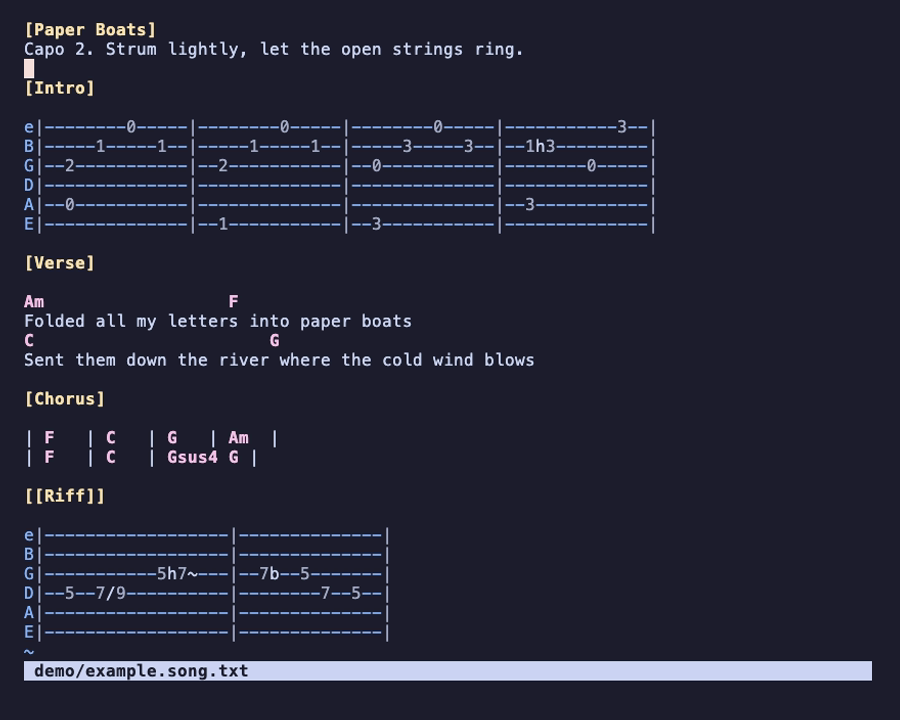
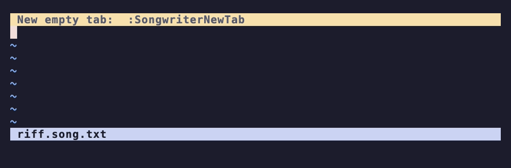

# vim-songwriter

[](https://github.com/williamdclt/vim-songwriter/actions/workflows/test.yml)

A Vim plugin for writing songs in plain text: guitar tabs, lyrics with chords
above them, and chord charts, all in one `.song.txt` file.

The files need no special syntax and no rendering step: they read the same in
any text editor. In Vim, the plugin highlights them and adds keys that edit tabs
note by note while keeping every string aligned.



([demo/example.song.txt](demo/example.song.txt) is the file shown here.)



## Installation

Requires Vim 8.2 or later (tested on Vim 9). Neovim is untested.

With [vim-plug](https://github.com/junegunn/vim-plug):

```vim
Plug 'williamdclt/vim-songwriter'
```

Or with Vim's built-in packages:

```bash
git clone https://github.com/williamdclt/vim-songwriter ~/.vim/pack/plugins/start/vim-songwriter
```

The plugin turns on for files named `*.song.txt` or `*.tab.txt`. It needs
`filetype plugin on` in your vimrc (most setups have it).

## Quick start

Open a new song and add an empty six-string tab:

```
vim my-song.song.txt
:SongwriterNewTab
```

The cursor is on the high e string, in **tablature mode**. Try, in order:

1. `a5789<Esc>` types four notes: `e|--5-7-8-9--|`.
2. `jjjj` goes down to the A string, then `a=Am<Enter><Esc>` adds an open A
   minor chord after them, on every string at once.
3. `dd` deletes that chord (the whole column); `p` pastes it back.

Every edit keeps the strings the same length, so the tab stays aligned.

Above a lyric line, write chord names (`Am      F`). With the cursor on one,
`<C-A>` / `<C-X>` transpose it a semitone up / down.

## File format

| Element       | Example                       |
|---------------|-------------------------------|
| Section       | `[Chorus]`, `[[Bridge]]`      |
| Chord         | `Am`, `F#sus4`, `D/F#`        |
| Tab line      | `e\|--3--5h7--x--\|`          |
| Anything else | lyrics, notes                 |

In a tab, a note is a fret number (`12`) or `x` (muted). Anything else between
notes (`h`, `p`, `/`, `b`, `~`…) is a technique marker, kept as is. Tabs are
separated by blank lines. [specification.song.txt](specification.song.txt) has
the full format.

## Tablature mode

Tablature mode is on when a file opens; `<leader>t` toggles it. In it, keys on
a tab line act on **time columns** (the notes played together, across all
strings) and keep the tab aligned. The current column is highlighted. Off a tab
line, Vim behaves as usual.

Like Vim itself, it has a normal state (moving never changes the tab) and an
insert state, shown as `-- TAB INSERT --`, where moving opens room for new
notes.

### Writing notes

| Key            | Action                                                       |
|----------------|--------------------------------------------------------------|
| `0`–`9`        | Write a fret (`1` `2` for `12`)                              |
| `x` on a dash  | Write a muted note                                           |
| `a` / `i`      | Open a slot after / before the note, enter the insert state  |
| `<Esc>`        | Leave the insert state (an unused slot disappears)           |
| `o` / `O`      | New empty tab below / above, same tuning                     |
| `_`            | Insert a dash on every string                                |
| `\|\|`          | Align and tidy the tab                                       |

In the insert state:

- Notes are typed one after the other: `a5789` gives `5-7-8-9`. Two digits make
  one fret only when that is a real fret (up to 24): `12` is one note, `25` is
  two. `<Space>` ends a note early: `1 5` is `1` then `5`.
- `l` / `h` step through notes and the gaps between them, opening a slot in
  each gap; `l` past the last note adds a bar.
- `j` / `k` after a note stay on its column, to type a chord shape: `5j7`.
- Technique markers are typed after a note: `5h7`, `7b`, `5/9~`.
- The arrow keys carry the note under the cursor to another string or column.

`<leader>k` / `<leader>j` copy the note under the cursor onto the string above /
below and enter a move state, shown as `-- TAB MOVE --`: there `hjkl` carry the
copy as the arrow keys do, and the original stays. `<Esc>` or `<leader>` ends
it.

Edit an existing marker with Vim's `f` and `r`: `fhr/` turns a hammer-on into a
slide.

### Writing chords

| Key                  | Action                                                  |
|----------------------|---------------------------------------------------------|
| `=Am<Enter>`         | Write the chord on the column, rooted on the cursor's string |
| `==`                 | Right after: cycle to the next voicing of that chord    |
| `=M7<Enter>`         | Change the quality of the chord on the column           |
| `+`                  | Build a chord up from the note: power, major, minor     |

Shapes cover major, `m`, `7`, `m7`, `maj7`, `sus2` and `sus4` in standard
tuning. Power chords (`=E5`) follow any tuning.

### Moving

| Key             | Moves to                                          |
|-----------------|---------------------------------------------------|
| `w` / `b`       | next / previous note on the string                |
| `l` / `h`       | next / previous time column (any string)          |
| `L` / `H`       | same, but never opens a slot in the insert state  |
| `W` / `B` / `E` | start of next bar / start of bar / end of bar     |

### Editing columns

Operators act on whole time columns, on every string.

| Key                 | Action                                                   |
|---------------------|----------------------------------------------------------|
| `x`                 | Erase the note                                           |
| `dd` `yy` `cc`      | Delete / yank / change the time column (`Y` = `yy`)      |
| `D` / `C`           | Delete / change to the end of the bar                    |
| `p` / `P`           | Paste columns or bars after / before the cursor's        |
| `gp`                | Overlay a column onto the current one (add a bass note)  |
| `>>` / `<<`         | Push the column one dash later / earlier                 |
| `sk` / `sj`         | Move the note one string up / down, same fret            |
| `Sk` / `Sj`         | Same, keeping the pitch                                  |
| `sK` `sJ` `SK` `SJ` | Same, for the whole time column                          |
| `<C-A>` / `<C-X>`   | Move the note up / down a fret (every note in visual); also `]` / `[` |
| `V`                 | Select the time column                                   |
| `.`                 | Repeat                                                   |

Operators take motions (`dw`, `dW`, `d$`) and these text objects:

| Object          | Selects                                     |
|-----------------|---------------------------------------------|
| `ic` / `ac`     | time column / plus the gap after it         |
| `i\|` / `a\|`     | bar / plus one bar line                     |
| `in` / `an`     | single note / plus its gap                  |
| `ap`            | whole tab                                   |

`j` / `k` limit an operator to some strings: `dj` erases the column's notes on
this string and the next, `dJ` down to the bottom string. Since digits type
notes, put counts after the operator: `d3d`, `d2ac`.

Outside tablature mode, tab lines are plain text with smarter motions (`w` / `b`
skip dashes, `W` / `B` jump between bar lines).

### Listening

`<leader>p` is an operator that plays notes, with a plucked-string sound. It
takes the same targets as `d` and `y`, and never changes the file:

| Key                  | Plays                                         |
|----------------------|-----------------------------------------------|
| `<leader>P`          | the note under the cursor                     |
| `<leader>pp`         | the time column                               |
| `<leader>pi\|`       | the bar                                       |
| `<leader>pap`        | the whole tab                                 |
| `<leader>p` (visual) | the selection                                 |

Columns play one after the other, a half beat each at 120 bpm
(`g:songwriter_play_bpm`), whatever the spacing; the notes of a column are
strummed from the lowest string up. `:SongwriterStop` stops.

The sounds are generated by the plugin; playing them needs an audio player
command: `afplay` (macOS), `paplay` or `aplay` (Linux). Without one, nothing
else is affected. Pitches follow the string names (standard tuning is E2 to
E4).

## Chords in lyrics

| Key                 | Action                                                 |
|---------------------|--------------------------------------------------------|
| `<C-A>` / `<C-X>`   | Transpose the chord up / down a semitone (takes a count; in visual mode, every chord in the selection); also `]` / `[` |
| `<leader>m`         | Toggle minor / major                                   |

Off a chord, `<C-A>` / `<C-X>` (and `]` / `[`) increment numbers as usual.
`]` / `[` replace Vim's own `]`/`[` commands in song files.

## Commands

| Command                             | Action                                         |
|-------------------------------------|------------------------------------------------|
| `:SongwriterNewTab [strings]`       | New empty tab (default `eBGDAE`; bass: `GDAE`) |
| `:SongwriterLint`                   | Align and tidy the tab (`\|\|`)                 |
| `:SongwriterAddDash`                | Insert a dash on every string (`_`)            |
| `:SongwriterAddDashes`              | Append `--` to every string                    |
| `:SongwriterAddBar`                 | Insert a bar line after the cursor             |
| `:SongwriterChordAbove {chord}`     | Write a chord above the cursor, aligned        |
| `:SongwriterTabChord {chord}`       | Write a chord name above the tab, at the cursor |
| `:SongwriterChordQuality {quality}` | Change the chord's quality (`sus4`, `m7`…)     |
| `:SongwriterTransposeChord {n}`     | Transpose the chord by `n` semitones           |
| `:SongwriterToggleMinorMajor`       | Toggle minor / major                           |
| `:SongwriterToggleTabMode`          | Toggle tablature mode                          |
| `:SongwriterStop`                   | Stop playing                                   |

## Customization

Remap the default keys through their `<Plug>` mappings:

| Default     | `<Plug>` mapping                        |
|-------------|-----------------------------------------|
| `<C-A>`     | `<Plug>(songwriter-transpose-up)`       |
| `<C-X>`     | `<Plug>(songwriter-transpose-down)`     |
| `]` / `[`   | `<Plug>(songwriter-transpose-up)` / `-down` |
| `<leader>k` | `<Plug>(songwriter-duplicate-up)`       |
| `<leader>j` | `<Plug>(songwriter-duplicate-down)`     |
| `<leader>`  | `<Plug>(songwriter-end-move)`           |
| `<leader>m` | `<Plug>(songwriter-toggle-minor-major)` |
| `<leader>t` | `<Plug>(songwriter-toggle-tabmode)`     |
| `<leader>p` | `<Plug>(songwriter-play)` (normal and visual) |
| `<leader>P` | `<Plug>(songwriter-play-note)`          |
| `\|\|`       | `<Plug>(songwriter-lint)`               |
| `_`         | `<Plug>(songwriter-add-dash)`           |

- `g:songwriter_max_fret` (default 24): the highest fret a two-digit note can be.
- `g:songwriter_play_bpm` (default 120): playing speed, a time column per half
  beat.
- `g:songwriter_strum_ms` (default 80): delay between the notes of a column,
  lowest string first (`0` plays them at once).
- `g:songwriter_player`: the command that plays a sound file, as a list (the
  file is appended), e.g. `['paplay']`. `[]` turns sound off.
- `g:songwriter_sound_cache`: where the generated sounds are kept (default
  `$XDG_CACHE_HOME/vim-songwriter`, or `~/.cache/vim-songwriter`).
- The `songwriterTimeColumn` highlight group (linked to `CursorColumn`) colors
  the current time column.
- To show `TAB INSERT` in your status line:

  ```vim
  set statusline+=%{exists('*songwriter#keys#Mode')?songwriter#keys#Mode():''}
  ```

## Development

`make test` runs the [Vader.vim](https://github.com/junegunn/vader.vim) suite
(cloned on first run), one Vim per test file in parallel (`make test JOBS=1`
runs them one at a time). `make hooks` enables the pre-commit hook, which runs the
tests. Design decisions are in [design.md](design.md).

The README images are recorded with [VHS](https://github.com/charmbracelet/vhs):
`vhs demo/screenshot.tape` and `vhs demo/tabs.tape` from the repository root.

Inspired by [vim-guitar-tab](https://github.com/matt-snider/vim-guitar-tab) and
[chordpro.vim](https://github.com/vim-scripts/chordpro.vim).
